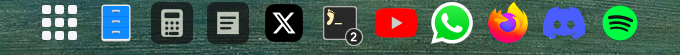

# Dock Window Counter

Window counts for apps on the **current workspace**, drawn over Omarchy's existing floating dock.



- One window: an outlined white dot below the app icon.
- Multiple windows: a dark badge with the exact count.
- No windows on this workspace: no marker.
- Each monitor follows its own active workspace.
- Minimized windows count on their saved original workspace when that metadata is available.
- Omarchy agent terminal windows count with the configured terminal app; dedicated TUI app identities stay separate.

This is an independent indicator overlay. It draws no app icons, creates no dock, handles no clicks, launches no apps, and modifies no other plugin. Its empty input region lets clicks, hover, dragging, and minimize/restore interactions pass through to the dock underneath.

## Requirements

Omarchy Quattro with the Quickshell shell and an already-visible dock using Omarchy's native icon sizes, slot spacing, pins, and ordering. The overlay reads public dock settings and Hyprland window metadata. Other dock layouts are not supported.

No extra runtime packages, network requests, privileged commands, or polling. The existing `xdg-terminal-exec --print-id` command is called once to identify the configured terminal; it does not launch one. Python 3 and Node.js are development-only dependencies for checks.

## Install

```sh
omarchy plugin add https://github.com/nacho1706/omarchy-dock-window-counter --enable
```

The stable plugin ID is `chato.floating-apps`. This plugin can remain enabled alongside the separate service that provides your dock. It never enables, disables, patches, or replaces that service.

For a local checkout, copy this folder to `~/.config/omarchy/plugins/chato.floating-apps/`, then:

```sh
omarchy plugin validate ~/.config/omarchy/plugins/chato.floating-apps
omarchy-shell shell rescanPlugins
omarchy plugin enable chato.floating-apps
```

## Visibility and layout

Indicators appear on floating workspaces. They are hidden for maximized/fullscreen workspaces and when dock autohide is enabled: the dock's reveal state is private, so this avoids leaving markers above a hidden dock. Disable dock autohide to use the overlay.

Positions are calculated from Omarchy's native dock geometry and current pins. Markers settle into their final positions after reordering; they do not follow an icon while it is being dragged or magnified on hover. The project does not control the underlying dock's brightness or activation behavior.

## Disable or remove

```sh
omarchy plugin disable chato.floating-apps
omarchy plugin remove chato.floating-apps
```

Only the overlay disappears. No other project's code or settings need restoring.

## Validation

```sh
omarchy plugin validate .
python3 tools/check.py
node test/workspace.test.cjs
/usr/lib/qt6/bin/qmllint --max-warnings 10000 Service.qml CounterWindow.qml
```

Qt 6 syntax checking emits unresolved Omarchy host-import warnings outside the running shell. See `VERIFICATION.md` for live checks and limits.

## License and marketplace

Original overlay code is MIT-licensed. The app-ordering model is adapted from Omarchy's native dock; its copyright and license are preserved in `UPSTREAM_LICENSE` and `THIRD_PARTY_NOTICES.md`.

The [public repository](https://github.com/nacho1706/omarchy-dock-window-counter) includes the root manifest, preview, documentation and marketplace submission draft. Listing requires separate owner review and marketplace approval.
